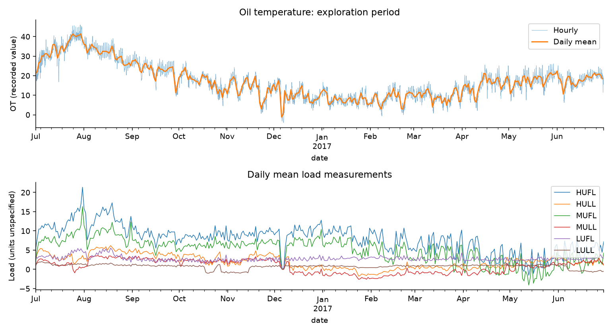
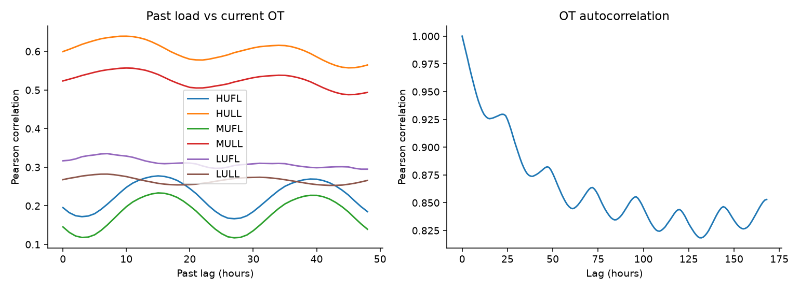

# ETTh1 初期EDA

## 範囲と前提

- 元データ：`assignment-main/data/ETTh1.csv`。
- 全期間では欠損・時刻重複・時間間隔のみ確認。
- 分布・相関・図表は2016-07-01〜2017-06-30の8,760行に限定。
- 年間の変動を見るため、最初の12か月を探索期間として暫定設定した。後続8,660行は今回の詳細分析から保留し、検証・テストの具体的境界はモデル構築前に確定する。
- 仮の予測条件は、予測時点までの負荷・油温から1時間先のOTを予測するもの。
- 単位の裏付けがないため、図表では記録値として表示する。

| 画像 | 調べる内容 |
|---|---|
| `eda_overview.png` | 初年度全体の油温と負荷の変化 |
| `eda_week.png` | 最初の7日間の細かな変化 |
| `eda_correlations.png` | 同時刻の変数同士の相関 |
| `eda_lags.png` | 過去の負荷との相関、油温の自己相関 |
| `eda_distribution.png` | 油温の分布と1時間ごとの変化量 |

## 確認できたこと

### 1. 基本的な時刻・欠損の問題はない

全17,420行、2016-07-01 00:00〜2018-06-26 19:00。全列欠損なし、日時重複なし、隣接行はすべて1時間間隔。ただし、この確認だけでセンサ値の正確性までは保証できない。

### 2. 油温は夏に高く、冬に低い傾向を示す

探索期間のOTは平均17.169、最小-4.080、最大46.007。7〜8月が高く、冬が低い。観測した1年間の傾向であり、毎年再現するかは未検証。外気温は列にないため、季節変化の原因は断定できない。

### 3. 直前の油温は重要な予測候補

OTと1時間前のOTの相関は0.993。

### 4. 負荷ではHULL・MULLとの相関が比較的大きい

同時刻のOTとのPearson相関はHULL=0.600、MULL=0.524、LUFL=0.317、LULL=0.268、HUFL=0.195、MUFL=0.145。

### 5. 過去の負荷も候補になるが、時間差の解釈は慎重に行う

0〜48時間前の負荷を調べたところ、HULL・MULLは10時間前との相関の絶対値が最大。一方、24時間程度の波も見られる。

### 6. 負値・急変は削除前に調査が必要

負荷6列すべてに負値がある。定義・計測方法が十分に分からないため、負値を自動的に異常値とは扱わない。OTには1時間で約9.9変化する箇所もある（例：2017-05-22 19:00）。実現象かセンサ等の問題かは未判定であり、前後の負荷や温度との照合が必要。

図表は`outputs/figures/eda_*.png`、集計は`outputs/metrics/eda_*.csv`と`eda_quality.json`に保存される。
